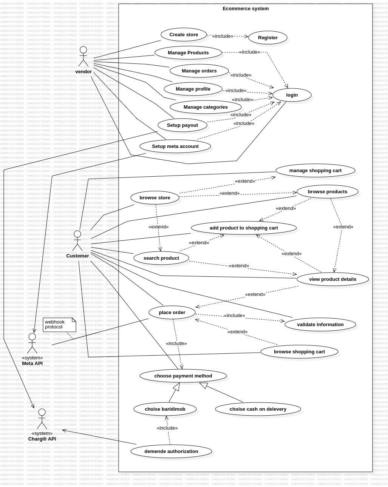
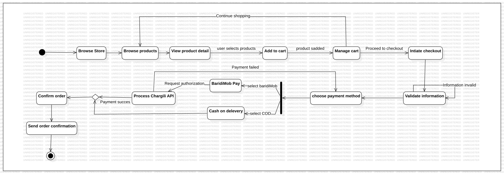
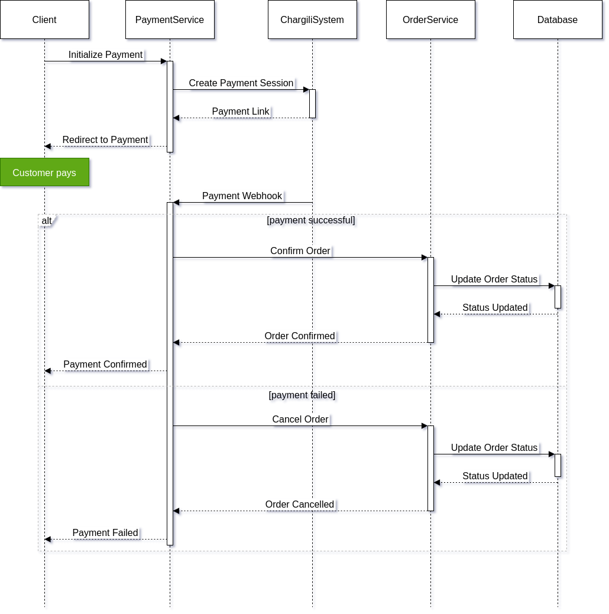
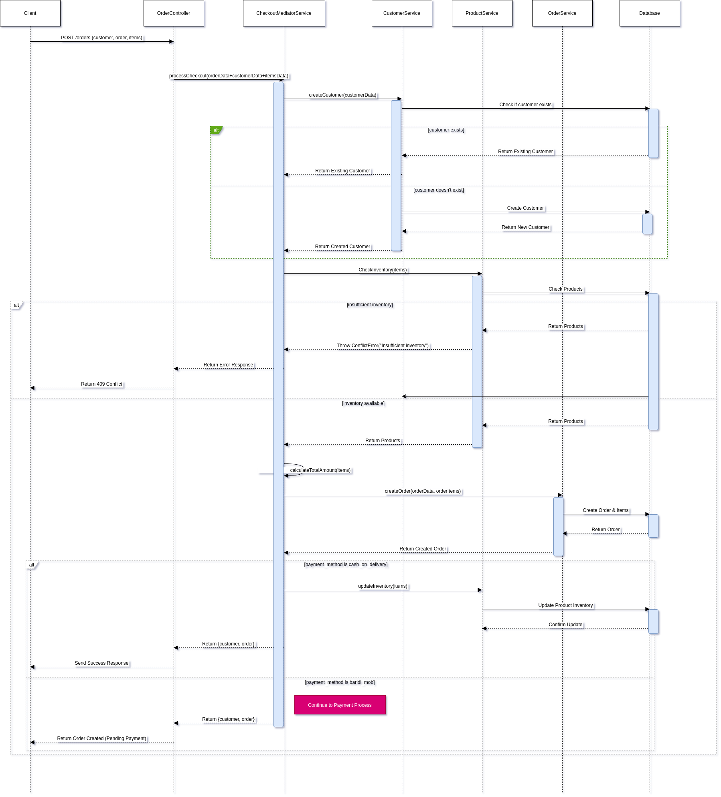
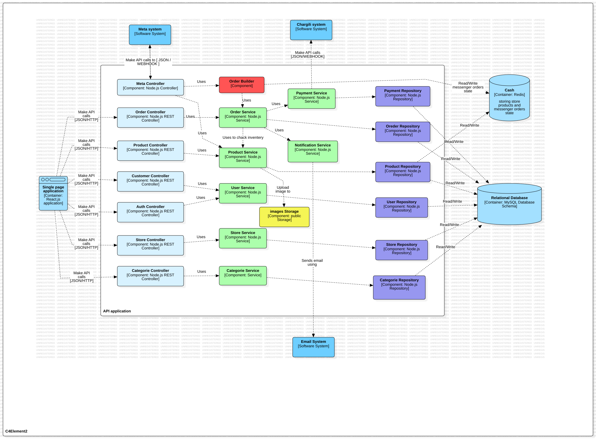
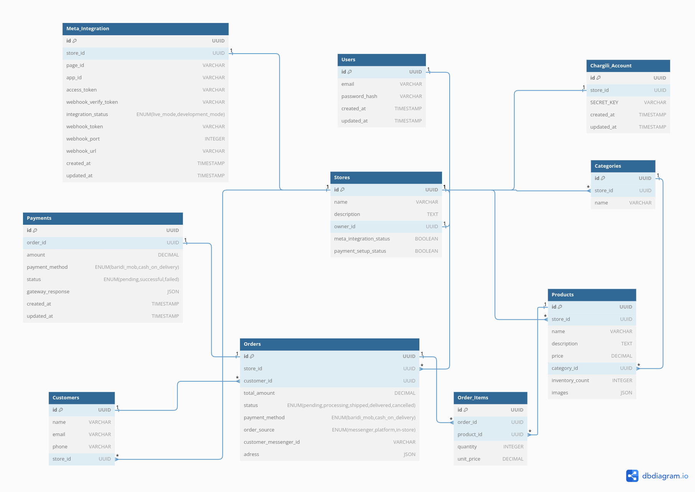

# Complete Ecommerce System Specification

## Table of Contents :

## List of Figures :

1. [C4 Model Context Diagram](#c4-model-context-diagram)
2. [C4 Model Container Diagram](#c4-model-container-diagram)
3. [Payment Sequence Diagram](#payment-sequence-diagram)
4. [Place Order Sequence Diagram](#place-order-sequence-diagram)
5. [Use Case Diagram](#use-case-diagram)
6. [Activity Diagram](#activity-diagram)
7. [Component Diagram](#component-diagram)
8. [Entity-Relationship Diagram](#entity-relationship-diagram)
9. [Messenger Integration Screenshot](#messenger-integration-screenshot)

---

1. [Requirement Gathering and Understanding](#1-requirement-gathering-and-understanding)

   - [System Actors](#11-system-actors)
   - [Functional Requirements](#12-functional-requirements)
   - [Non-Functional Requirements](#13-non-functional-requirements)
   - [Use Case Diagram](#use-case-diagram)
   - [Activity Diagram](#activity-diagram)


2. [System Design](#2-system-design)
   - [Project Structure Visualization](#project-structure-visualization)
     &nbsp;&nbsp;&nbsp;&nbsp;- [C4 Model Context Diagram](#c4-model-context-diagram)
     &nbsp;&nbsp;&nbsp;&nbsp;- [C4 Model Container Diagram](#c4-model-container-diagram)
     &nbsp;&nbsp;&nbsp;&nbsp;- [Payment Sequence Diagram](#payment-sequence-diagram)
     &nbsp;&nbsp;&nbsp;&nbsp;- [Place Order Sequence Diagram](#place-order-sequence-diagram)
     &nbsp;&nbsp;&nbsp;&nbsp;- [Messenger Integration Screenshot](#messenger-integration-screenshot)
   - [API Architecture](#system-api-design)
   - [System Architecture](#system-architecture)
     &nbsp;&nbsp;&nbsp;&nbsp;- [Component Design (C4 Diagram)](#system-architecture)
   - [Database Design](#full-database-schema)
     &nbsp;&nbsp;&nbsp;&nbsp;- [Entity-Relationship Diagram](#entity-relationship-diagram)
     &nbsp;&nbsp;&nbsp;&nbsp;-[Table Schemas](#users-table)
     &nbsp;&nbsp;&nbsp;&nbsp;- [Relationships](#relationships)
     &nbsp;&nbsp;&nbsp;&nbsp;- [Constraints](#relationship-constraints-explanation)

---


# 1. Requirement Gathering and Understanding

## 1.1 System Actors

1. Vendor
2. Customer
3. External Systems
   - Chargili API (Payments)
   - Meta API (Messenger)

## 1.2 Functional Requirements

### 1.2.1 Vendor Functions

#### 1.2.1.1 Store Management

- Create and manage store
- Register and log in
- Setup payouts and Meta integration

#### 1.2.1.2 Product Management

- Add, edit, delete products
- Set prices, manage inventory, upload images

#### 1.2.1.3 Category Management

- Create and organize categories
- Edit category structure

#### 1.2.1.4 Order Management

- View, process, and update orders
- Handle website and Messenger orders
- View history, generate reports

### 1.2.2 Customer Functions

#### 1.2.2.1 Website Shopping

- Browse, search, and view products
- Manage cart and place orders
- Choose payment:
  - Cash on delivery
  - Baridimob
- Get order confirmations

#### 1.2.2.2 Messenger Shopping

- Browse and order products via Messenger
- Use cash on delivery
- Get confirmations and updates

### 1.2.3 System Functions

#### 1.2.3.1 Payment Processing

- Integrate Chargili API
- Process payments and refunds
- Manage cash on delivery orders

#### 1.2.3.2 Meta Integration

- Connect Messenger
- Handle messages and orders
- Send responses and updates

#### 1.2.3.3 Order Processing

- Validate info, track status
- Send notifications, update inventory
- Generate invoices

## 1.3 Non-Functional Requirements

### 1.3.1 Performance

- System shall load product pages within 3 seconds
- System shall handle at least 10000 concurrent users
- System shall process payment transactions within 3 seconds

### 1.3.2 Security

- System shall encrypt all sensitive data in transit and at rest
- System shall implement rate limiting for API endpoints

### 1.3.3 Usability

- System shall be accessible on mobile and desktop devices
- System interface shall be intuitive and user-friendly
- System shall provide clear error messages and feedback

### 1.3.4 Scalability

- System shall implement caching mechanisms

### 1.3.5 Maintainability

- System shall follow layered architecture
- System shall maintain comprehensive documentation
- System shall support version control for content

## Use Case Diagram



## Activity Diagram



# 2. System Design :

## Project Structure Visualization

This section provides a comprehensive visual overview of the e-commerce platform's architecture and key processes.

### C4 Model Context Diagram

The context diagram shows the high-level view of the system and how it interacts with external actors and systems.


**Key Elements:**
- **Store Owner**: Manages store, products, and orders through the platform
- **Customer**: Browses products and places orders via website or Messenger
- **E-commerce Platform System**: The core system providing all functionality
- **Meta (External System)**: Integrates with Messenger for chat commerce
- **Chargily Payment (External System)**: Processes payments securely

### C4 Model Container Diagram

The container diagram provides a detailed view of the system's internal structure and technology choices.


**Key Components:**
- **Single Page Application**: React-based frontend for store management and customer shopping
- **API Application**: Backend services handling business logic and data processing
- **Database**: MySQL storage for all persistent data
- **Cache**: Redis for improved performance and session management
- **External Integrations**: Meta API for Messenger and Chargily for payments

### Payment Sequence Diagram

This diagram illustrates the complete payment processing flow within the system.



**Payment Flow:**
1. Client initializes payment request
2. Payment service creates session with Chargily system
3. Customer is redirected to payment gateway
4. Payment webhook confirms transaction status
5. Order service updates order status accordingly
6. Customer receives payment confirmation

### Place Order Sequence Diagram

This diagram shows the detailed process of placing an order through the platform.



**Order Placement Flow:**
1. Customer submits order through the platform
2. Order controller validates customer and product data
3. Customer service checks/creates customer record
4. Product service validates product availability
5. Order service creates order and updates inventory
6. Payment processing is initiated if required
7. Order confirmation is sent to customer

### Messenger Integration Screenshot

The platform integrates with Facebook Messenger to enable chat commerce functionality.


**Messenger Features:**
- Direct product browsing through chat interface
- Order placement via conversational flow
- Real-time order status updates
- Customer support integration
- Seamless transition between web and chat commerce

---

# System API Design

## 1. API Architecture Overview

### Base URL Structure

```
https://ecommerce.com
```

### Authentication Endpoints

```
POST   /api/v1/auth/register
POST   /api/v1/auth/login
POST   /api/v1/auth/refresh-token
POST   /api/v1/auth/logout
```

### JWT Payload Structure

The payload includes user information and the associated storeId:

{
"sub": "12345", // User ID (subject)
"email": "user@example.com", // User's email
"storeId": "67890", // Associated store ID (null if not applicable)
"iat": 1691376400, // Issued at time (Unix timestamp)
"exp": 1691462800 // Expiration time (Unix timestamp)
}

### Store Management API

```
GET    /api/v1/stores/{storeId}                 # Get store details and products
POST   /api/v1/stores                              # Create new store
PUT    /api/v1/stores                   # Update store
POST   /api/v1/stores/meta-integration  # Setup Meta integration
POST   /api/v1/stores/payment-setup     # Setup payment methods
```

### Product Management API

```
POST   /api/v1/products                      # Create product
GET    /api/v1/stores/{storeId}/products/{productId}          # Get product details
GET    /api/v1/stores/{storeId}/products          # Get products details
PUT    /api/v1/products/{productId}          # Update product
DELETE /api/v1/products/{productId}          # Delete product
PATCH  /api/v1/products/{productId}/inventory # Update inventory
POST   /api/v1/products/{productId}/images   # Upload images
```

### Category Management API

```
POST   /api/v1/stores/{storeId}/categories                    # Create category
GET    /api/v1/stores/{storeId}/categories                    # List categories
```

### Order Management API

```
POST   /api/v1/orders                                  # Create order
GET    /api/v1/orders/{orderId}                       # Get order details
GET    /api/v1/orders                # List store orders
PATCH  /api/v1/orders/{orderId}/status # Update order status
```

### Meta Integration API

```
POST   /api/v1/messenger/webhook                   # Handle Meta webhook
GET   /api/v1/messenger/webhook                   # verify webhook

```

### Customer Management API

```
POST   /api/v1/customers                                 # Create new customer
PUT   /api/v1/customers/{customerID}                                # update customer details
GET    /api/v1/customers                       # List store customers
GET    /api/v1/customers/{customerID}                # Get customer details and orders
```

## 2. Query Parameters

Common query parameters for list endpoints:

```
page: number (default: 1)
limit: number (default: 20)
sort: string (e.g., "createdAt:desc")
filter: object (endpoint-specific filters)
```

Example product filtering:

```
GET /api/v1/stores/{storeId}/products?
    category=cat_123&
    minPrice=1000&
    maxPrice=2000&
    search=keyword
```

## 3. Error Responses

```json
{
  "success": false,
  "error": {
    "code": "VALIDATION_ERROR",
    "message": "Invalid input parameters",
    "details": {
      "field": ["error message"]
    }
  }
}
```

## 4. Headers

Required headers for all requests:

```
Authorization: Bearer <token>
Accept: application/json
Content-Type: application/json
```

# System Architecture
## Component Diagram



### Controllers

- REST API endpoints
- Request validation
- Auth handling
- Route management

### Services

- Business logic
- Transaction handling
- Integration management
- Data orchestration

### Repositories

- Database operations
- CRUD handling
- Query management
- Entity relations

### Order Builder

- Order construction
- Validation logic
- Business rules
- Workflow management

## Data Storage

### MySQL Database

- Data storage

### Redis Cache

```markdown
Store Products:

- Product data caching

Messenger Orders:

- Chat order states
- Conversation context
- Real-time updates
```

### Public Storage

- Image management
- File uploads
- Asset storage
- Media handling

## Frontend

### Single Page Application

- React.js UI
- API integration
- State management
- User interaction

## External Systems

### Meta System

- Facebook integration
- Messenger communication
- Webhook processing
- Order syncing

### Chargili System

- Payment processing
- Authorization
- Transaction management
- Payment API integration

## Full Database Schema

## Entity-Relationship Diagram



### Users Table

```markdown
- `id`: UUID (Primary Key)
- `email`: VARCHAR
- `password_hash`: VARCHAR
- `created_at`: TIMESTAMP
- `updated_at`: TIMESTAMP
```

### Stores Table

```markdown
- `id`: UUID (Primary Key)
- `name`: VARCHAR
- `description`: TEXT
- `owner_id`: UUID UNIQUE (Foreign Key to Users)
- `meta_integration_status`: BOOLEAN
- `payment_setup_status`: BOOLEAN
```

### Products Table

```markdown
- `id`: UUID (Primary Key)
- `store_id`: UUID (Foreign Key to Stores)
- `name`: VARCHAR
- `description`: TEXT
- `price`: DECIMAL
- `category_id`: UUID (Foreign Key to Categories)
- `inventory_count`: INTEGER
- `images`: JSON (array of image URLs or paths)
```

### Categories Table

```markdown
- `id`: UUID (Primary Key)
- `store_id`: UUID (Foreign Key to Stores)
- `name`: VARCHAR
```

### Orders Table

```markdown
- `id`: UUID (Primary Key)
- `store_id`: UUID (Foreign Key to Stores)
- `customer_id`: UUID (Foreign Key to Customers)
- `total_amount`: DECIMAL
- `status`: ENUM
  - 'pending'
  - 'processing'
  - 'shipped'
  - 'delivered'
  - 'cancelled'
- `payment_method`: ENUM
  - 'baridi_mob'
  - 'cash_on_delivery'
- `order_source`: ENUM ('messenger', 'platform', 'in-store') (Default: 'platform')
- `customer_messenger_id`: VARCHAR
- `adress`: JSON
```

### Order_Items Table

```markdown
- `id`: UUID (Primary Key)
- `order_id`: UUID (Foreign Key to Orders)
- `product_id`: UUID (Foreign Key to Products)
- `quantity`: INTEGER
- `unit_price`: DECIMAL
```

### Customers Table

```markdown
- `id`: UUID (Primary Key)
- `name`: VARCHAR
- `email`: VARCHAR
- `phone`: VARCHAR
- `store_id`: UUID (Foreign Key to Stores)
```

### Payments Table

```markdown
- `id`: UUID (Primary Key)
- `order_id`: UUID UNIQUE (Foreign Key to Orders)
- `amount`: DECIMAL
- `payment_method`: ENUM
  - 'baridi_mob'
  - 'cash_on_delivery'
- `status`: ENUM
  - 'pending'
  - 'successful'
  - 'failed'
- `gateway_response`: JSON
- `created_at`: TIMESTAMP
- `updated_at`: TIMESTAMP
```

### Meta_Integration Table

```markdown
- `id`: UUID (Primary Key)
- `store_id`: UUID UNIQUE (Foreign Key to Stores)
- `page_id`: VARCHAR
- `app_id`: VARCHAR
- `access_token`: VARCHAR
- `webhook_verify_token`: VARCHAR
- `integration_status`: ENUM
  - 'live_mode'
  - 'development_mode'
- 'webhook_token': VARCHAR
- 'webhook_port': INTEGER
- 'webhook_url': VARCHAR
- `created_at`: TIMESTAMP
- `updated_at`: TIMESTAMP
```

### Chargili_Account Table

```markdown
- `id`: UUID (Primary Key)
- `store_id`: UUID UNIQUE (Foreign Key to Stores)
- `SECRET_KEY` : VARCHAR
- `created_at`: TIMESTAMP
- `updated_at`: TIMESTAMP
```

## Relationships

### One-to-One Relationships:

1. `Stores.owner_id` → `Users.id`: Each store has a unique owner.
2. `Payments.order_id` → `Orders.id`: Each payment corresponds to a unique order.
3. `Meta_Integration.store_id` → `Stores.id`: Each store has one Meta integration.
4. `Chargili_Account.store_id` → `Stores.id`: Each store has one Chargili account.

### One-to-Many Relationships:

1. `Stores.id` → `Products.store_id`: A store can have multiple products.
2. `Stores.id` → `Categories.store_id`: A store can have multiple categories.
3. `Stores.id` → `Orders.store_id`: A store can have multiple orders.
4. `Stores.id` → `Customers.store_id`: A store can have multiple customers.

5. `Categories.id` → `Products.category_id`: A category can include multiple products.

### Many-to-Many Relationships:

1. **Products and Orders**:
   - **Through Order_Items**: Products can appear in multiple orders, and orders can contain multiple products. This relationship is managed via the `Order_Items` table, which connects the **Products** and **Orders** tables.

### Relationship Constraints Explanation

#### 1. Cascade

- Automatically deletes related records when the parent record is deleted
- Used when child records cannot exist without the parent
- Example: Deleting a Store deletes all its Products, Categories, Orders

#### 2. Restrict

- Prevents deletion of a record if related records exist
- Protects against unintended data loss
- Example: Cannot delete a Customer with existing Orders

#### 3. SetNull

- Sets foreign key to NULL when parent record is deleted
- Allows child records to exist independently
- Example: Deleting a Category sets `category_id` to NULL in Products

### Recommended Relationship Constraint Patterns

1. **Strong Relationships (Cascade)**

   - Store → Products
   - Store → Categories
   - Store → Orders
   - Store → Customers

2. **Protected Relationships (Restrict)**

   - Order → Payment
   - Customer → Orders

3. **Flexible Relationships (SetNull)**
   - Product → Category
