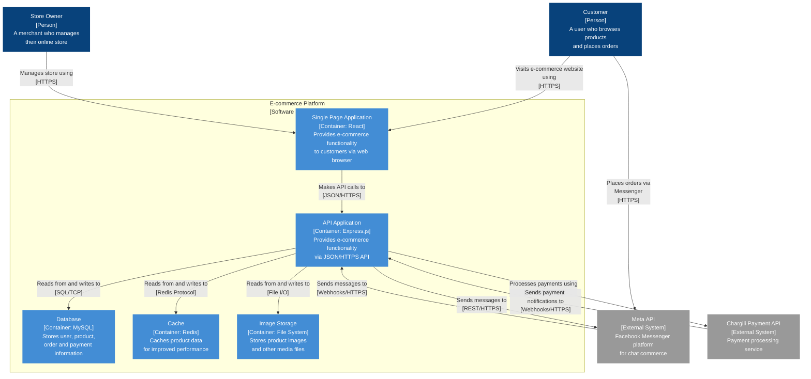

# C4 Container Diagram (Level 2)

This container diagram shows the main components of the E-commerce Platform:

1. **Single Page Application (React)** - Provides the user interface for customers and store owners
2. **API Application (Express.js)** - Handles all business logic and API requests
3. **Database (MySQL)** - Stores user, product, order, and payment information
4. **Cache (Redis)** - Provides caching for improved performance
5. **Image Storage (File System)** - Stores product images and other media files

The diagram follows the C4 model notation guidelines:
- Each element includes its type (Person, Container, External System)
- Each element has a short description of its responsibilities
- Each container specifies its technology
- All relationships are labeled with descriptions and technologies/protocols
- Relationships show clear direction and intent
