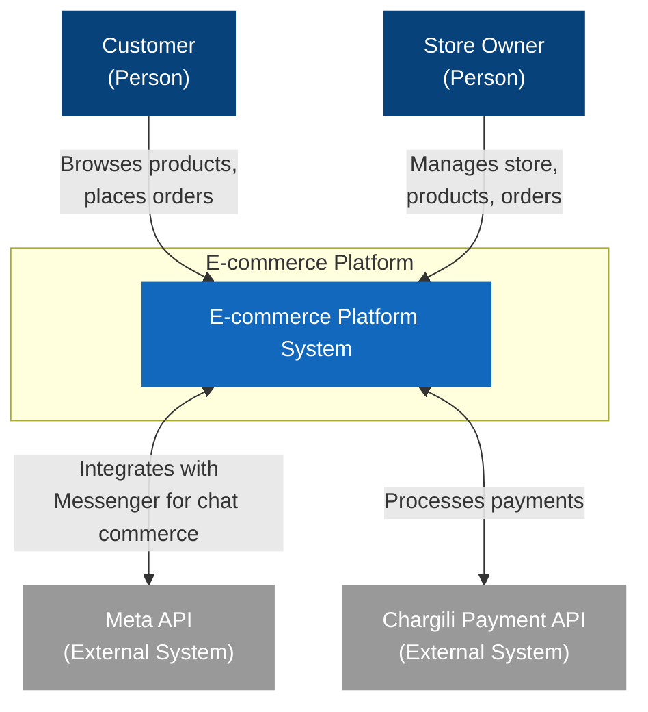

# C4 Context Diagram (Level 1)

This context diagram shows the high-level interactions between users (Customers and Store Owners) and external systems (Meta API for Messenger integration and Chargili Payment API) with the E-commerce Platform.
