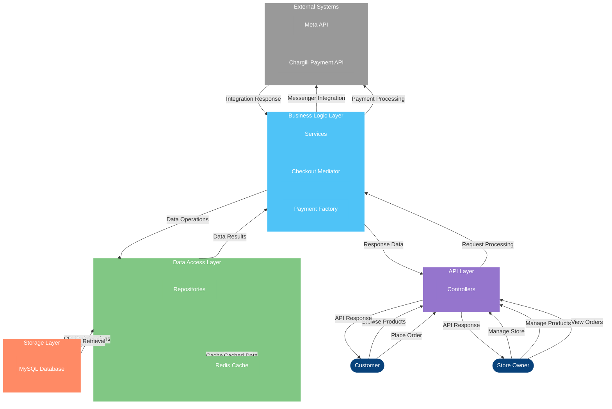

# Data Flow Diagram

This data flow diagram illustrates how data moves through the E-commerce Platform system, from user interactions through the various layers of the application to the database and external systems.
